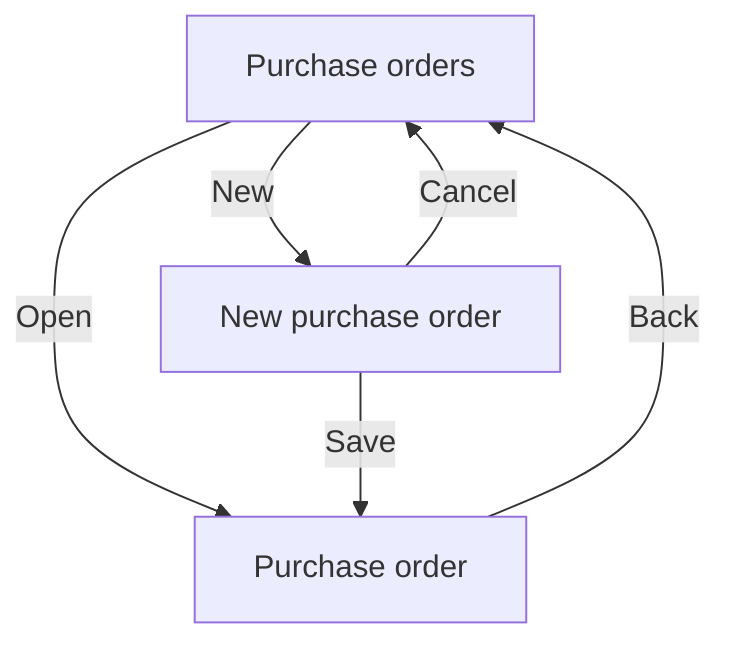

# Flows: purchase orders

## 1. Screen inventory

| Id | Screen | Story | Exits |
| --- | --- | --- | --- |
| S-01 | Purchase orders | US-03-002 | New to S-02, open to S-03 |
| S-02 | New purchase order | US-03-001 | Save to S-03, cancel to S-01 |
| S-03 | Purchase order | US-03-003, US-03-004, US-03-005, US-03-006 | Back to S-01 |

## Flowchart

## 2. Interaction states

### S-01 Purchase orders

| State | The user sees | Copy |
| --- | --- | --- |
| loading | skeleton rows | "Purchase orders" |
| empty | invitation to create the first order | "No purchase orders yet" |
| error | banner with retry | "Could not load purchase orders. Retry." |
| success | the list, newest first, 50 per page | "Purchase orders" |

### S-02 New purchase order

| State | The user sees | Copy |
| --- | --- | --- |
| loading | disabled form while saving | "Saving" |
| empty | n/a: the form is always shown | |
| error | banner with retry | "Could not save. Retry." |
| `error: quantity_out_of_range` | the line and field marked | "Quantity must be 1 to 10,000." |
| success | the new draft opens | "Draft saved" |

### S-03 Purchase order

| State | The user sees | Copy |
| --- | --- | --- |
| loading | skeleton lines | "Purchase order" |
| empty | n/a: an order always has lines | |
| `error: forbidden_self_approval` | inline banner | "You cannot approve your own order." |
| error | banner with retry | "Could not load this order. Retry." |
| success | lines, total and the actions the role allows | "Purchase order" |

## Task paths

| Task | Story | Kind | Entry | Path | Screens | Interactions | Over |
| --- | --- | --- | --- | --- | --- | --- | --- |
| Create a draft | US-03-001 | primary | S-01 | S-01: tap New > S-02: pick supplier, add line, tap Save | 2 | 4 | |
| Find an order | US-03-002 | primary | S-01 | S-01: filter by status, open order > S-03 | 2 | 2 | |
| Submit an order | US-03-004 | primary | S-03 | S-03: tap Submit | 1 | 1 | |
| Approve an order | US-03-005 | primary | S-03 | S-03: tap Approve | 1 | 1 | |
| Cancel an order | US-03-006 | secondary | S-03 | S-03: tap Cancel | 1 | 1 | |
